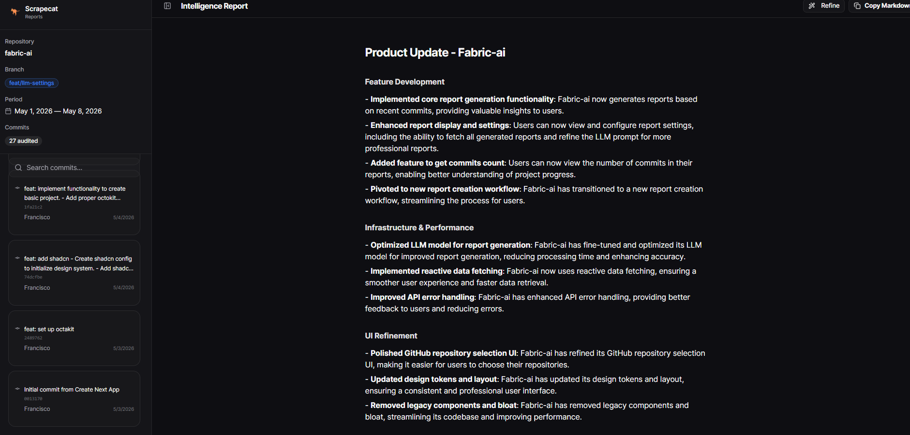
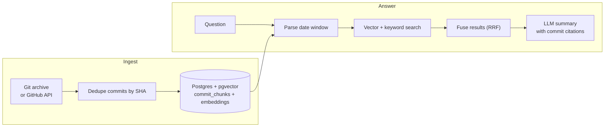

<p align="center">
  
</p>

<br>

[](https://hub.xerj.org/contributors/franciscoluna-28)

## 🐈 Scrapecat - Git should explain your project

Scrapecat is an engineering intelligence assistant that answers questions about your repository's history and engineering progress, connect to a repo and understand what your team has been working on.

Built by a former founding engineer to stop generating reports and communicating technical progress by hand. Come on it's 2026, stop guessing what your engineers are doing. 

## Tech Stack
- **Backend:** Fastify 5 (Node.js), Drizzle ORM + PostgreSQL (pgvector)
- **Frontend:** Next.js 16 (React 19), TanStack React Query, Tailwind CSS v4, shadcn/ui + AI Elements
- **Data Source:** GitHub and GitLab APIs for discovery, native git archive for self-hosted commit ingestion, GitHub REST for demo ingestion
- **Intelligence:** OpenRouter, OpenCode Go, or Ollama (local LLMs), with protocol-aware provider routing
- **Package Manager:** pnpm workspaces

## Core Features

- **RAG Chat:** Ask questions about your code history in natural language. The system retrieves the most relevant commits via vector search (pgvector HNSW index) and summarizes them with an LLM.
- **Feature-Level Summaries:** Related commits are grouped by feature, bug fix, refactor, or infrastructure — no individual commit listing unless asked.
- **Source Citations:** Every AI response includes a collapsible "Sources Used" section with direct links to provider commits.
- **Project Tree Sidebar:** Connected repositories with nested chat sessions, branch selector, and navigation.
- **Audience Personas:** Choose a Founder, CTO, or Engineer tone per conversation; the same history is synthesized for the selected audience.
- **Model Selection:** Pick the chat model per conversation; configure the embedding model in Settings.

## Future Roadmap
- **External Integrations:** Connect Slack, Linear, Jira, and Notion so summaries cross-reference commits with tickets, messages, and docs.
- **Enterprise-Grade Security:** E2E Encryption, SSO, and Organization-level RBAC.

AI is increasing commit velocity, not reducing it. Scrapecat is the missing layer that translates engineering output into something every department can actually understand.

## How it works



Ingestion is batch/archive-based (see [`docs/architecture.md`](./docs/architecture.md)); retrieval fuses vector and keyword results over Postgres (the read model) and abstains when the evidence is weak.

## Demo Mode (public concept demo)

Scrapecat ships a serverless-first **demo profile** used for the public, hosted
concept demo. It runs on a Node-compatible serverless host — the current
deployment guide targets Vercel — and reads public repos over the GitHub REST API
with no git binary or disk. Every read is served from PostgreSQL, and visitors
are locked to a pre-ingested repository set. It is opt-in via env vars and does
not change the self-hosted product. See [`docs/demo.md`](./docs/demo.md) and
[`docs/deploy-vercel.md`](./docs/deploy-vercel.md).

## Getting Started

### 1. GitHub API Configuration

Scrapecat requires a Personal Access Token (PAT) to fetch repository metadata and commit history.

- 1.  Navigate to [GitHub Settings](https://github.com/settings) > Developer Settings > Personal Access Tokens.
- 2.  Ensure the `repo` (Full control of private repositories) and `read:org` scopes are enabled.
- 3. Scrapecat treats your data as read-only. We analyze metadata to answer questions without ever modifying your source code.

### 2. OpenRouter Intelligence Layer

We use OpenRouter's API for LLM access. The free tier works out of the box.

- 1. Sign up at [OpenRouter](https://openrouter.ai/keys) and create a free API key.
- 2. Default chat model is set by `AI_MODEL` (default `mimo-v2.6-flash`); override anytime in the Settings UI or per conversation.

### 3. Ollama (Local Alternative)

Ollama runs LLMs locally — no API key, no cloud, no data leaves your machine.

**Setup:**

1. Install Ollama from [ollama.com](https://ollama.com/download)
2. Pull the tested defaults for this project:
   ```bash
   ollama pull llama3.2:1b        # Chat: 1.2B params, ~1.3 GB
   ollama pull nomic-embed-text   # Embeddings: 768 dims, ~274 MB
   ```
3. Verify Ollama is running and sees both models:
   ```bash
   curl http://localhost:11434/api/tags
   ollama list
   ```
4. In a chat, open the model selector and choose `Ollama (Local)` → `llama3.2:1b`
5. In **Settings** (`/settings`), set **Embedding Provider** to `Ollama (Local)` → `nomic-embed-text`
6. No API key is needed. Set `OLLAMA_BASE_URL` only if Ollama is not on the default port

**Available models are fetched automatically** from your local Ollama instance — only installed models appear in the dropdown.

**Verified local setup:** `llama3.2:1b` handles chat and `nomic-embed-text` returns 768-dimensional embeddings, matching the `vector(768)` column. Quick check:

```bash
ollama run llama3.2:1b "Reply with exactly: Scrapecat local support ready"
```

> **Docker users:** The backend connects to Ollama via `host.docker.internal`. Both compose files set this, so no extra config is needed when Ollama runs on the host.

### 4. OpenCode Go (Optional, Chat)

[OpenCode Go](https://opencode.ai/console) is an optional subscription gateway for open coding models (GLM, Kimi, DeepSeek, MiMo, and others). It is **chat-only** — embeddings still use OpenRouter or Ollama.

- Subscribe and copy the API key from the OpenCode Console.
- Store it in **Settings → API Keys**, or set `OPENCODE_GO_API_KEY`.
- Pick an OpenCode Go model in the chat model selector. Models are listed with their native endpoint (OpenAI Chat Completions, OpenAI Responses, or Anthropic Messages); Scrapecat routes each model to the matching protocol automatically.

## Environment Setup

```bash
cp backend/.env.example backend/.env
```

At minimum, set `OPENROUTER_API_KEY` (LLM access — free key at
[openrouter.ai/keys](https://openrouter.ai/keys)) and, for self-hosted,
`GITHUB_TOKEN` (repository access — [github.com/settings/tokens](https://github.com/settings/tokens)).
GitLab is supported too: connect a token in Settings, or set `GITLAB_TOKEN`
(`read_api`, `read_repository`) and `GITLAB_HOST` for a self-hosted instance.

For the full list of backend and frontend variables, their defaults, and
copy-paste demo/self-hosted configurations, see
[`docs/environment.md`](./docs/environment.md).

> **Using Ollama?** No additional env vars needed — just ensure Ollama is running locally and select it in the Settings UI.

## Local Deployment

```bash
# Install dependencies
pnpm install

# Generate database migration
pnpm run db:generate

# Apply migrations (creates projects, commit_chunks, chat_sessions, credentials tables)
pnpm run db:migrate

# Start the development server
pnpm run dev
```

The application will be live at http://localhost:3000. Connect your first repository and start asking questions about your code history.

## Docker Setup

### Prerequisites
- [Docker](https://docs.docker.com/get-docker/) and [Docker Compose](https://docs.docker.com/compose/install/)

### Development (hot reload)

```bash
docker compose up --build
```

Three services start:
- **Postgres (pgvector)** at http://localhost:5432 — persisted via a named volume
- **Backend** (Fastify) at http://localhost:4000 — auto-reloads via `tsx watch`
- **Frontend** (Next.js) at http://localhost:3000 — HMR via `next dev`

### Stop

```bash
docker compose down
```

### Production (self-hosted clients)

Workspace-aware production images live next to each app:
[`backend/Dockerfile`](./backend/Dockerfile) and
[`frontend/Dockerfile`](./frontend/Dockerfile). Run the full stack with:

```bash
docker compose -f docker-compose.prod.yml up -d --build
```

The backend image runs migrations on boot, ships native `git`, and healthchecks
the readiness route. Set `NEXT_PUBLIC_API_URL` to the backend URL as seen by the
browser. See [`docs/deployment.md`](./docs/deployment.md) for env, volumes,
migrations, and multi-replica notes. The Vercel/serverless deployment is separate
and unchanged — see [`docs/deploy-vercel.md`](./docs/deploy-vercel.md).

## Architecture

### RAG Pipeline

1. **Query parsing** — natural language date windows are parsed ("last 30 days", "since June", "2024") and applied as metadata filters
2. **Hybrid retrieval** — vector search over the pgvector HNSW index (`MAX_COSINE_DISTANCE = 0.8`) and keyword search run in parallel
3. **Fusion** — results are merged with reciprocal rank fusion (RRF); weak evidence abstains instead of surfacing the nearest commits
4. **LLM summarization** — system prompt instructs the LLM to group by feature, not list individual commits
5. **Sources** — every response includes a collapsible "Sources Used" section with commit links

## Contributing

We welcome contributions from engineers who understand that documentation is as important as code.

- **Guidelines:** [CONTRIBUTING.md](CONTRIBUTING.md)
- **Code of Conduct:** [CODE_OF_CONDUCT.md](CODE_OF_CONDUCT.md)
- **Security Policy:** [SECURITY.md](SECURITY.md)
- **Accessibility:** [ACCESSIBILITY.md](ACCESSIBILITY.md)
- **Bug Reports:** Open an issue with a clear reproduction script and environment details.
- **Feature Requests:** Focused on scalability, retrieval accuracy, and developer autonomy.

## License

This project is licensed under the MIT License.

---

Scrapecat | Built for the builders.
_Engineered by Francisco Luna_
