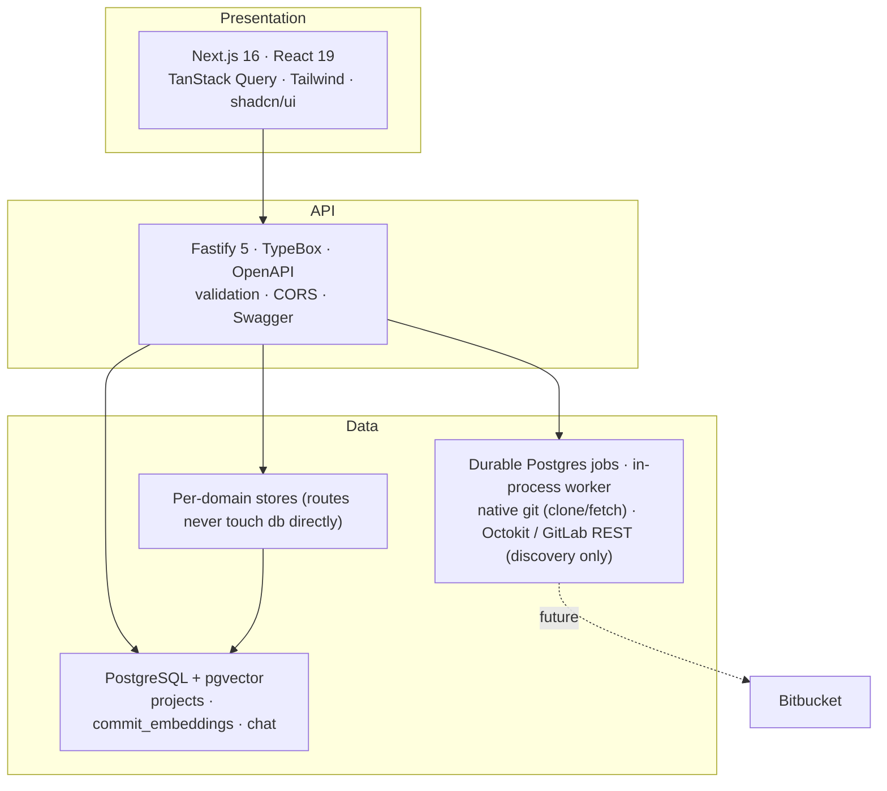
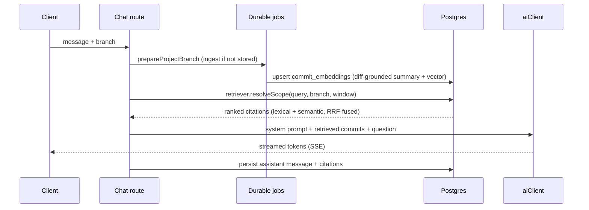
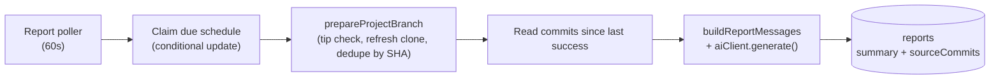
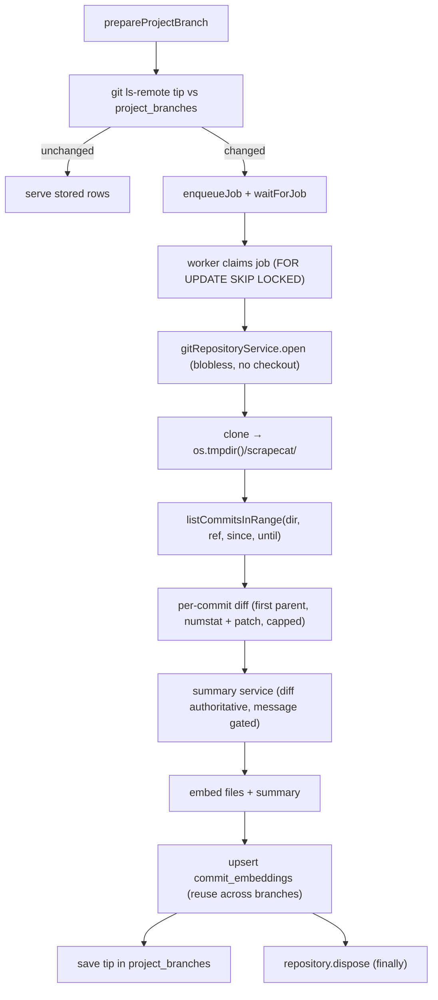
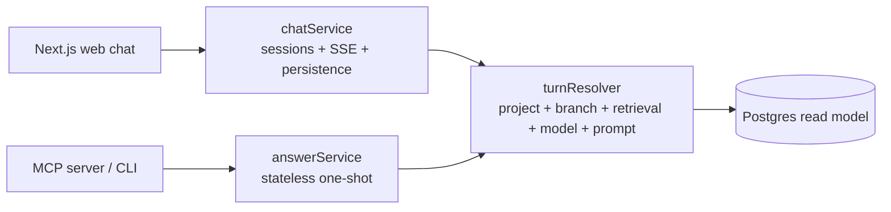

# Architecture

Scrapecat is a RAG chat over a repository's git history. Commits are ingested into
Postgres (the read model), embedded, and retrieved by semantic + keyword search
to ground an LLM answer.

## Tiers

## Backend layout

The backend is grouped by tier (see `backend/AGENTS.md` → "API layer"):

- `src/api/` — HTTP domains: `chat`, `credentials`, `repositories`,
  `settings`, `reports`, `system`. Each owns its `routes.ts`, `schemas.ts`,
  services, stores, and colocated tests.
- `src/rag/` — the retrieval/indexing pipeline: `answer`, `context`,
  `retrieval`, `indexing`, `git`, `github`, `eval`.
- `src/shared/` — cross-cutting infrastructure: `integrations/`, `storage/`,
  `queue/`, `config/`, `utils/`.
- `src/startup/` — server composition (`create-server.ts`,
  `register-routes.ts`); `src/build-app.ts` is the public entrypoint.
- `src/db/` — DB client, schema, and migrations.

## RAG pipeline

`POST /api/v1/chat/sessions/:id/messages` ingests the branch if needed, then
retrieves, then streams the answer.

- **Hybrid retrieval** runs semantic and lexical channels in parallel and fuses
  them with reciprocal rank fusion (`src/rag/retrieval/fusion.ts`), so agreement
  between channels wins without score calibration. Semantic hits are capped at
  `MAX_COSINE_DISTANCE = 0.8`. Lexical search uses a `search_vector` tsvector
  over summary, file paths, and the original message (GIN-indexed); it covers
  exact identifiers and queries where embeddings are missing or fail. Default
  limit: `5`; hard ceiling: `20`.
- **One semantic ceiling.** Semantic hits above `MAX_COSINE_DISTANCE = 0.8` are
  dropped; there is no corroboration/threshold stack. Abort only when both
  channels return nothing.
- **Date windows** ("last 30 days", "since June") are parsed into column
  filters; temporal summary queries read the whole window rather than top-k.
  Relative phrases without an explicit date are not silently anchored.
- **Grounding** is the diff-grounded commit summary plus file scope — see [`embeddings.md`](embeddings.md).
- **Quality** is measured with golden-set retrieval evals (`pnpm eval`) — see
  [`evaluation.md`](evaluation.md).

## Scheduled reports

Daily and weekly in-app summaries reuse the chat model settings and the same
ingestion path. Schedules live in `report_schedules`, generated summaries in
`reports`; each schedule targets one project branch (unique on project +
branch).

- `startReportScheduler()` runs in the long-running backend (`main.ts`);
  serverless/Vercel and demo mode skip it, and report routes return 403 in demo.
- A run uses the period since `lastSuccessAt`, so a missed or failed run is
  covered by the next successful one instead of replaying every interval.
- Schedule writes use a clock check (`lastRunAt`) plus a conditional claim so a
  manual run cannot double-fire and due schedules are not run twice.
- V1 supports daily/weekly cadence and one schedule per branch; custom cron,
  multi-project schedules, and email/Slack delivery are not built.

## Durable jobs

Heavy work runs as Postgres-backed jobs (`jobs` table) instead of an in-memory
queue. `enqueueJob` inserts a row with an optional idempotency key (unique while
queued/running, so concurrent callers dedupe); `waitForJob` polls the row's
`progress`/`status` and replays progress to the caller. The worker
(`src/shared/queue/worker.ts`) claims due rows with `FOR UPDATE SKIP LOCKED`,
runs the registered handler, writes `result`/`error`, and retries with backoff
up to `max_attempts`. It runs in the API process (`WORKER_ENABLED`, default
true); serverless (Vercel) runs the handler inline because it cannot host a
long-running loop. On boot, any `running` rows left by a crash are marked failed
so waiters fail fast instead of hanging. This first version targets one process
and one database, not replicas or horizontal scale: the worker takes a Postgres
advisory lock at startup, so a second replica serves API only.

## Commit ingestion

Batched, run as a deduped durable job. The job selects a `CommitSource` — the
self-hosted ephemeral workspace (`createGitCommitSource`) or the demo GitHub API
(`createApiCommitSource`) — and a shared orchestrator (`ingestCommits`) runs the
pipeline either way. Callers enqueue `ingest-branch` and await it; the in-process
worker claims it from Postgres, and the stable idempotency key makes concurrent
callers for the same project+branch attach to the same run.

- **Two sources:** `createGitCommitSource` (self-hosted; native git diffs) and
  `createApiCommitSource` (demo; GitHub `files[].patch`) both feed the same
  `ingestCommits` orchestrator. Both apply the same exclusions and caps.
- **Diff is the source of truth:** summaries are generated from the cleaned,
  capped diff. The commit message is a hint only when the rule gate considers it
  trustworthy; junk or missing messages are omitted from the prompt.
- **Dedupe and reuse:** the tip check skips unchanged branches; within a run,
  `(repo_id, commit_sha, diff_hash, summary_version, summary_model)` is reused
  across branches so the same commit is summarized once.
- **Failure handling:** the only remote step is the clone/diff (retryable).
  A summary failure falls back to a structural summary; an embedding failure
  stores the summary without a vector and is retried by reindex.

### Why no persistent clone cache

The clone is a workbench, not a cache. Postgres (`commit_embeddings`,
`project_branches`) is the durable read model and answers every query. A clone
only needs to exist while an ingest job reads git objects, so it is deleted in a
`finally` and swept on boot after a crash.

This is deliberate at the current scale:

- `git ls-remote` + `project_branches.tip_sha` make an unchanged branch cost no
  clone at all.
- A moved branch pays one blobless clone (`--filter=blob:none`) — commits and
  trees, not the repo's file blobs.
- There is no volume to provision, no cache repair, no project-delete cleanup,
  and no per-repo locking.

A persistent repo-level cache would only optimize repeated large-history
ingests. If measured clone time ever dominates, add it then: key it by
`provider/owner/repo` so branches share one object store, keep it blobless with
incremental `git fetch`, and self-heal a broken dir by re-cloning. Do not build
a distributed cache. Tracked as P3-9.

### Why native git (not a JS git library)

`src/rag/git/git.ts` shells out to the system `git` binary with `execFile`,
baked into the image (`backend/Dockerfile.dev`). Do **not** replace it with
`isomorphic-git`, `nodegit`, etc.:

- **Off-loop, bounded memory** — a separate C process keeps pack/delta work off
  the V8 heap, which is what makes the in-process job worker safe and large
  clones non-OOMing.
- **Protocol maturity** — single-branch/blobless clone, packfiles,
  `http.extraheader` auth, fast `log`/`diff-tree` on huge repos.
- **Reproducibility** — pinning git gives identical behavior across dev,
  replicas, and prod.
- **Ephemeral by design** — the blobless clone lives in `os.tmpdir()` and is
  deleted in a `finally`; a crash is swept on the next worker boot.

Serverless cannot run the binary at all — which is why the demo uses the GitHub
REST API. The clean split: self-hosted ships git; serverless does not and uses
the API path.

## Operational safety

- **Bounded LLM calls.** `aiClient` applies `AI_TIMEOUT_MS` to every chat request
  and caps output at `AI_MAX_OUTPUT_TOKENS` (default `8192`) unless the caller
  overrides `maxTokens`; embedding calls use the same timeout with one retry. SSE handlers abort the
  upstream call when the client disconnects.
- **Graceful shutdown.** `SIGTERM`/`SIGINT` stop the job worker, let the current
  job finish, and then close the Fastify server. Jobs interrupted by a hard crash
  are failed on the next worker boot so callers do not wait forever.
- **Readiness.** `GET /api/v1/health/ready` runs `select 1` against Postgres and
  returns 503 when it cannot connect; `GET /api/v1/health` stays a liveness probe.
  Docker images use the readiness route for their healthcheck.
- **Fail fast on config.** `ENCRYPTION_KEY` is validated as base64-encoded 32
  bytes at startup instead of failing at the first encrypt/decrypt call.

## Model resolution

Two roles, each with a provider + model setting stored in `app_settings`:

| Role | Setting | Default (self-hosted) | Default (demo) |
|---|---|---|---|
| Chat (RAG answer) | `chatProvider` / `chatModel` | `ollama` / `llama3.2:1b` | `openrouter` / `env.AI_MODEL` |
| Embeddings | `embeddingProvider` / `embeddingModel` | `ollama` / `nomic-embed-text` | `openrouter` / `env.EMBEDDING_MODEL` |

Precedence: a per-conversation override (chat only) → stored `app_settings` row →
`defaultAISettings()`. Outside demo mode the fallback is local Ollama so a
self-hosted install works without a cloud key; demo uses OpenRouter because
visitors cannot run Ollama. Chat calls go through
`resolveChatModel()` → `aiClient.generate()` / `aiClient.stream()` in
`src/rag/answer/ai.ts`; embeddings through `embedTexts()` in
`src/rag/indexing/embeddings.ts`. Each `commit_embeddings` row stores its
embedding provider/model, and retrieval only searches vectors in the current
space; changing the embedding model enqueues a background reindex.

Chat model ids are resolved through the provider catalog
(`src/shared/integrations/providers/catalog.ts`), which records each model's
transport protocol (`openai-chat`, `openai-responses`, `anthropic-messages`, or
`google-generative`). `protocols.ts` is the only module that imports model SDKs;
`createAIClient()` hands it the registry config, catalog entry, and key. The
client factory, `createTurnResolver()`, `createChatService()`, and
`createAnswerService()` are the DI seams — tests inject fake SDK functions or
fake turn dependencies instead of mocking the whole call path.
The RAG stages are explicit: `createRetriever()` owns `retriever.resolveScope()`
(query window + semantic/keyword search), prompt assembly stays pure, and
`turnResolver` composes project/branch/retrieval/model/prompt for both the web
chat (`chatService` + `aiClient.stream()`) and the stateless MCP/CLI path
(`answerService` + `aiClient.generate()`).

## Multiple clients (web chat and MCP)

Scrapecat has two front doors over one RAG pipeline: the stateful Next.js chat
and a stateless MCP/CLI path. They must not reimplement retrieval, prompts, or
model resolution, so the turn is split into a shared core and thin clients:

- `src/rag/answer/turn.ts` owns project lookup, branch selection, retrieval
  (`resolveScope` or an explicit window), model resolution, and prompt
  assembly. It never creates sessions, writes messages, or touches Fastify/SSE.
- `src/api/chat/services.ts` is the web-only facade: sessions, history, streaming,
  and persistence. It passes `prepareProjectBranch` into the turn resolver so
  the web chat can ingest on demand.
- `src/rag/answer/answer.ts` is the stateless one-shot path. It calls the same turn
  resolver and `aiClient.generate()`, with no session or message writes. MCP
  tools can omit the prepare callback, keeping them read-only over indexed
  commits.
- `search_commits` (future MCP tool) uses the retriever directly;
  `summarize_period` uses `answerService`.

Rule of thumb: a change that affects both clients (persona, retrieval, prompt,
model selection) belongs in `turn.ts` and must be covered by the turn tests.
Transport and persistence concerns stay in `services.ts`, `routes.ts`, or the
MCP adapters.

## Tech debt

Every shortcut below is intentional and tracked, not accidental. Frontend-only
debt is tracked separately in
[`frontend-tech-debt.md`](./frontend-tech-debt.md).

### Git provider coupling

External data flows through `src/shared/integrations/git-provider/`. The
registry owns each provider's URLs, clone auth, env key, and client factory;
`getGitProvider(provider, token)` returns the interface, never a concrete
adapter. Connection routes are provider-generic
(`/api/v1/git-providers/:provider/connection`) and all token precedence lives in
`resolveGitToken`. Adding a provider is a registry entry plus an adapter, not a
call-site sweep — GitLab (`GitlabAdapter` + a thin `fetch` client, self-hosted
via `GITLAB_HOST`) was exactly that. Full DI is deliberately unused: the
registry/factory is the seam and is enough for one adapter per provider.

### GitLab removal (planned)

GitLab support is being removed. Adoption was poor, GitHub is the only provider
the product needs, and GitHub's native features keep improving. The second
adapter costs more than it returns: it adds a provider registry entry, a separate
REST client, token and host env vars, `git_provider`/`credential_provider` enum
values, discovery fanout, clone/auth branches, and frontend provider selection
and URL parsing.

The removal covers the backend adapter/client and tests, GitLab env vars, DB enum
values (with a preflight so existing GitLab rows are handled explicitly), the
provider-generic discovery and connection surfaces, and the frontend provider
picker, icon, metadata, and URL parsing. After it lands, the remaining git
provider code collapses to a single GitHub module. Tracked as P2-10 in the
backlog.

### Database coupling

The DB client is initialized at module load in `src/db/client.ts`. Access goes
through per-domain stores; routes never import `db` directly. Stores export a
`createXStore(client?)` factory plus a default singleton, so methods bind the
client once and tests can inject a fake instead of mocking the module.

### No dependency injection

Services are imported at the top of files, not injected. Swapping implementations
means changing import paths everywhere; tests compensate with `vi.mock()`. This
is acceptable while each role has one implementation; revisit only when a real
multi-tenant/runtime plugin need appears.

### No end-user auth layer

Self-hosted is intentionally account-less: the API assumes one trusted operator,
which fits the open-source model. Request-level authorization still exists where
it matters — chat sessions are scoped by the client's anonymous ID
(`x-anonymous-id`), and demo mode (`DEMO_MODE`) forces `DEMO_RESTRICT_KEYS`, repo
restrictions, and rate limits. What is missing is identity and tenancy: no
accounts, login sessions, or per-user isolation, so opening the same API as
multi-tenant SaaS needs a rework.

### Production Docker images

Self-hosted clients build `backend/Dockerfile` and `frontend/Dockerfile` from the
workspace root; `docker-compose.prod.yml` wires them to Postgres with health-gated
startup. The backend image bundles `src/main.ts` and the migration runner with
esbuild, installs production dependencies only, ships the native `git` binary,
runs as `node`, and applies migrations on boot. The frontend builds Next's
standalone output (only when `NEXT_OUTPUT=standalone`, set by the Dockerfile) and
runs `server.js` as `nextjs`; the serverless Vercel path does not set that flag
and is unchanged (see [`deploy-vercel.md`](deploy-vercel.md)). Full instructions:
[`deployment.md`](deployment.md).

### Validation & data-integrity gaps

- `limit`/`per_page` on discovery endpoints are validated (1–100) and fail fast.
- No transactions: project upsert and commit ingest are separate writes. A
  mid-way failure leaves committed rows persisted (safe today — the read model
  is derived and regenerable).

### No project deletion

There is no `DELETE /api/v1/projects/:id` route or store method. Removing a
project currently requires direct database work. `project_branches` cascades
with the project, and no persistent clone is left behind (workspaces are temp
and swept), so only the endpoint + Postgres cascade are missing (P2-3).

### Pending embedding reads

`reindexAllProjects` loads the pending rows per project from
`listPendingEmbeddings({ repoId, space })` before embedding them. Ingestion
embeds inline per commit; the pending read only runs for the reindex job. If the
backlog grows large, add a bounded loop (`LIMIT` until empty) instead of loading
the whole list.

### Grounding and stored evidence

The summary is generated from the cleaned, capped diff (first parent, filtered,
per-file and total caps). The original commit message is stored for display and
lexical matching, but it is not the evidence: it is included in the summary
prompt only when the rule gate considers it trustworthy. Raw diffs are not
stored; citations redirect to `commit_url`.

### Idempotency is a natural key, not a layer

There is no generic request-idempotency middleware. Projects, credentials, and
git connections already upsert on their natural keys (`(git_provider,
provider_project_id)` and `provider`), so retries are harmless. The only
duplicate-write sharp edge was chat turns, where a retried send could add a
second user/assistant pair and call the model again. That is solved with one
nullable `chat_messages.client_message_id` column, a partial unique index on
`(session_id, role, client_message_id)`, and `ON CONFLICT DO NOTHING`: the
frontend generates one id per logical send, the backend dedupes and replays a
completed turn. No separate key table, hashing, locks, TTLs, or status machine.

A generic `idempotency_keys` design was considered and rejected as
overengineering for this app — it adds infrastructure for cases that natural
keys already cover.

## What needs to happen

Decouple in phases, no big-bang rewrites:

1. **Git provider interface** — GitHub-only. GitLab support is being removed
   (see Tech debt → GitLab removal); the registry/factory collapses to one
   adapter.
2. **Data access layer** — per-domain stores (already largely in place); vector
   search infrastructure is ready.
3. **Provider scope** — GitHub is the product. Bitbucket or any additional
   provider is deferred until adoption justifies a second adapter.

Full DI is not on the roadmap: the factory is the seam, and injecting services
would add ceremony without a second consumer. Each future migration: implement
behind the interface → keep the default → remove the old path when unused.
