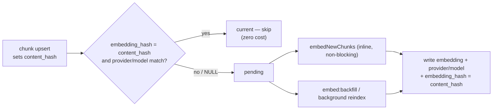

# Embeddings

How commit embeddings are produced, stored, and kept cheap. Semantic search over
these vectors backs RAG retrieval.

## Why this approach

1. **Cost.** Embedding full diffs burns tokens on patch noise (boilerplate,
   formatting, generated files) for little retrieval value. The corpus is the
   **commit message** — commit/PR review, not code review.
2. **Reliability.** Embedding must never block or fail chat retrieval. If the
   provider is down or out of quota, the keyword fallback still answers; vectors
   are a derived cache that catches up later.
3. **Correctness by construction.** A commit is immutable (identified by SHA), so
   stored content never changes — only its embedding can go stale, and that
   staleness is tracked explicitly.

## The corpus: the commit message

Each `commit_chunks` row stores the commit message (the embedding source) plus
metadata:

| Field | Source | Stored in |
|---|---|---|
| `sha` | local git log (native git) | `commit_sha` |
| `commit_message` | local git log | `commit_message` (embedding source) |
| `author` | local git log | `author` |
| `files_changed` | `git diff-tree --name-status` vs parent | `metadata` jsonb |
| `validation.status` (`confirmed`/`flagged`/`skipped`) + `notes` | rule guardrail | `metadata` jsonb |

No diff content is read at any point.

## Staleness gate: content + model identity

Two SHA-256 columns plus the provider/model identity make embedding idempotent,
incremental, and vector-space-safe:

- `content_hash` — hash of the stored `commit_message`; set on every upsert.
- `embedding_hash` — hash of the content the current `embedding` represents;
  `NULL` = never embedded.
- `embedding_provider` / `embedding_model` — the vector space of the stored
  embedding; `NULL` = legacy or never embedded.

A row's embedding is **current** iff all three are true:

1. `embedding_hash = content_hash`
2. `embedding_provider = current provider`
3. `embedding_model = current model`

Re-running over stored commits embeds **nothing**; a changed row or a changed
embedding model re-embeds exactly once. Retrieval only counts and searches
vectors in the current space, so old-model vectors are never compared with a new
query embedding.

## Provider and dimensions

- **Provider:** OpenRouter's OpenAI-compatible embeddings endpoint (reusing the
  OpenRouter key via `resolveApiKey("openrouter")` → `OPENROUTER_API_KEY`), or a
  local Ollama instance; both are on the embedding-provider allowlist.
- **Model:** the `embeddingModel` setting, defaulting to
  `openai/text-embedding-3-small` (env `EMBEDDING_MODEL` fallback).
- **Dimensions:** **768** — a database constraint shared by the
  `vector(768)` column and the HNSW index (`commit_embedding_hnsw_idx`, cosine).
  The single source of truth is `EMBEDDING_DIMENSIONS` in
  `src/shared/utils/embedding.ts`, imported by both `db/schema.ts` and the
  embedding client.
- **Allowlist:** only `text-embedding-3-small` and `text-embedding-3-large` are
  exposed on OpenRouter; both support the OpenAI `dimensions` override and are
  requested at 768 dims.
- **Ollama:** Ollama's OpenAI-compatible endpoint does not implement the OpenAI
  `dimensions` override, so the parameter is omitted (`embeddingDimensionsParam:
  false` in the provider registry). The selected Ollama model must natively emit
  768 dims (e.g. `nomic-embed-text`); the response is still length-checked.
- **Guarding:** every response is validated against `EMBEDDING_DIMENSIONS`
  (including Ollama), so a wrong-width vector fails the batch loudly instead of
  hitting the `vector(768)` column.
- **Model changes** make every existing row pending for the new space. The old
  vectors are retained until replaced, but retrieval ignores them; changing the
  model triggers a background reindex across all projects.

## When embeddings happen

1. **Inline, non-blocking** — after ingestion upserts new chunks,
   `embedNewChunks(projectId)` runs fire-and-forget (`void ... .catch(...)`).
   Retrieval never waits on it. On failure (no key, quota, outage) chunks stay
   persisted with `content_hash`; the next run or backfill catches up.
2. **Batch backfill** — `pnpm embed:backfill` (`backend/scripts/embed-backfill.ts`)
   walks every project and embeds pending rows in batches (`EMBEDDING_BATCH_SIZE`,
   default 100) — one HTTP call per batch.
3. **Background reindex** — changing `embeddingProvider` or `embeddingModel` in
   settings enqueues a `reindex-embeddings` job. It resolves the new space once,
   then re-embeds pending rows across every project; a failure in one project is
   logged and does not stop the others.

## Reliability & scaling

- **Bounded cost per run:** only SHAs not already stored are embedded
  (`getChunksByShas` skips existing) — same-range re-runs are free.
- **Graceful degradation:** embedding failures leave rows pending; ingestion never
  fails because of the embed step.
- **Resumable:** every step is idempotent and safe to re-run (dedupe by SHA).
- **Batched writes:** each embedding batch is written with one UNNEST-based
  `UPDATE`. The arrays are bound as parameters, so the SQL text stays fixed and
  only the payload scales with batch size.

## Status

- **Shipped:** archive-cloned file scopes, message-based corpus, content +
  model-identity staleness gate, inline non-blocking embed, batch backfill,
  background model-change reindex, OpenRouter provider wiring, `vector(768)`.
- **Not shipped (future):** RAG prompt enrichment and any retrieval consumer
  beyond the current chat path.
