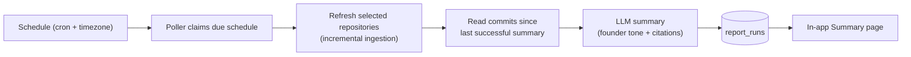

# Vision

## From asking to knowing

Scrapecat's job is to explain what a team shipped. Today that is mostly a pull
experience: connect a repository, ask a question, read the answer. The missing
habit is the one a founder actually wants — opening the app and already knowing
what changed.

**Summary is the daily, in-app report of what was built.**

No one should have to remember to ask "what did engineering do this week?"

## The feature

Summary is a scheduled digest generated from the same commit ingestion and
retrieval pipeline that powers chat. On a cadence the user chooses, Scrapecat:

- refreshes the selected repositories;
- reads the commits in the period since the last successful summary;
- groups the work into features, fixes, refactors, and infrastructure;
- writes a short, founder-oriented update with commit citations;
- stores it in the app, where it can be read, revisited, and followed up on in
  chat.

The default is a **daily summary**. Weekly and custom cron schedules are
supported. A schedule selects which repositories are included; unselected
repositories are excluded.

V1 is **in-app only**. There is no email, Slack, or webhook delivery yet. The
summary is the destination, not another notification to triage.

## Who it is for

- **Founders** who want a plain-language account of what the team shipped.
- **Product and engineering leads** who need a lightweight weekly/daily recap.
- **Anyone joining the project** who wants the recent story without reading
  every commit.

Chat remains the place for follow-up questions. Summary is the daily push.

## Principles

1. **Push, not pull.** A summary that requires a prompt is just chat with extra
   steps. The value is that the answer is waiting for you.
2. **Outcome language.** Describe what shipped and why it matters. Do not dump
   commits unless the reader asks.
3. **Grounded in history.** Every claim links back to commits and file scope.
   The commit message is a hint; the diff scope is the evidence.
4. **Quiet by default.** No notification spam. If nothing meaningful shipped,
   say so briefly instead of inventing activity.
5. **In-app first.** Build the reading experience and the schedule before
   expanding delivery channels.
6. **GitHub-only.** Scrapecat is a GitHub product. A second provider adds
   adapter, auth, env, schema, discovery, and UI surface without improving the
   core promise. GitLab support is being removed.

## User experience

- A **Summary** page in the app lists past summaries newest-first.
- A summary shows the period, the selected repositories, highlights, and the
  source commits behind each section.
- Settings expose the schedule: daily/weekly/custom cron, timezone, repository
  selection, enable/disable, and “run now”.
- Opening a summary is enough; asking a follow-up opens chat with the same
  project context.
- A missed run is caught up once on restart for the whole gap — not replayed
  interval by interval.

## How it works

- Schedules are installation-global; each schedule selects its own repositories.
- A poller runs in the long-running backend. Due schedules are claimed with
  `FOR UPDATE SKIP LOCKED`, so multiple instances do not send duplicates.
- Report runs are stored in Postgres, so a restart or a failed generation does
  not lose the schedule. The next successful run covers the gap.
- Ingestion is incremental: refresh starts from the latest stored commit rather
  than re-reading the full branch history.
- Summaries use the existing chat model settings and `aiClient.generate()`.
  There is no separate report model to configure in v1.

## What this is not

- Not a second dashboard, BI tool, or commit browser.
- Not a code-review tool or a replacement for GitHub pull requests.
- Not a real-time activity feed; the cadence is daily or slower.
- Not multi-tenant or per-user in v1. Schedules belong to the installation.
- Not a reason to add a durable job queue, Redis, or the old `sync_jobs` worker.
  `report_runs` is the durable record.

## Success

- A founder opens Summary without being prompted.
- The summary answers "what shipped?" in under a minute.
- Follow-up questions move into chat.
- Scheduled summaries stay fresh: a nonzero share of runs find new commits, and
  stale-data warnings are rare.
- Repository selection is intentional: teams include the repos they care about
  and exclude the noise.

## Roadmap

1. **V1 — daily in-app summaries.** Schedule, generate, store, and read reports
   inside Scrapecat.
2. **V2 — delivery and team cadence.** Optional email/Slack delivery, weekly
   digests, and multiple schedules per installation.
3. **V3 — external context.** Cross-reference tickets, docs, and chat where the
   integration clearly improves the summary. Not before the core habit works.

## Platform decision

GitLab support is being removed. Adoption was poor, GitHub is the only provider
the product needs, and GitHub's native features keep improving. Maintaining a
second adapter, client, token path, schema enum, discovery fanout, and frontend
surface costs more than it returns. The removal is tracked in the architecture
tech debt and backlog.
